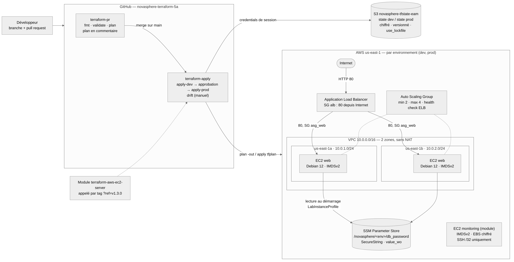

# Architecture NovaSphere



## Vue d'ensemble

Chaque environnement (`dev`, `prod`) est déployé à l'identique, à partir du même code, dans son
propre VPC et avec son propre state.

```
                         Internet
                            │ HTTP 80
                            ▼
             ┌─────────────────────────────────┐
             │    Application Load Balancer    │   SG alb : 80 depuis Internet
             └────────────────┬────────────────┘
                              │ 80, uniquement depuis le SG de l'ALB
 ┌─ VPC 10.0.0.0/16, sans NAT ─┼────────────────────────────────┐
 │                                                              │
 │  us-east-1a 10.0.1.0/24     │    us-east-1b 10.0.2.0/24      │
 │    ┌────────────┐           │           ┌────────────┐       │
 │    │  EC2 web   │◄──────────┴──────────►│  EC2 web   │       │
 │    └─────┬──────┘  Auto Scaling Group   └─────┬──────┘       │
 │          │         min 2 · max 4 · ELB         │             │
 └──────────┼─────────────────────────────────────┼─────────────┘
            └──────────────────┬──────────────────┘
                               │ lecture au démarrage (profil d'instance, IMDSv2)
                               ▼
       SSM Parameter Store  /novasphere/<env>/db_password  (SecureString, value_wo)

 State     : S3 novasphere-tfstate-eam — novasphere/dev/… et novasphere/prod/… — use_lockfile
 Livraison : PR → plan en commentaire → merge → apply dev → approbation → apply prod
```

## Décisions prises

| Sujet | Choix | Raison |
|---|---|---|
| Environnements | Répertoires `envs/dev` et `envs/prod`, un state par environnement | Isolation complète des états ; ce qui est validé en dev est exactement ce qui part en prod |
| Différences dev / prod | Uniquement la clé du backend et les valeurs des variables | Le code des deux répertoires est identique : aucune divergence possible |
| State partagé | Un bucket d'équipe, dans le compte de lab du référent AWS | Chaque membre a un lab distinct ; un seul compte peut porter le state de démonstration |
| Verrouillage | Verrou natif S3 (`use_lockfile = true`) | Plus besoin de table DynamoDB depuis Terraform 1.10 |
| Réseau | Module public `terraform-aws-modules/vpc/aws`, 2 zones, subnets publics, pas de NAT | Exigé par le cahier ; la NAT Gateway est facturée à l'heure et inutile ici |
| Calcul | ALB + ASG (minimum 2) sur Launch Template, `health_check_type = "ELB"` | Une instance qui ne répond plus sur `/` est remplacée automatiquement |
| Module de l'équipe | `terraform-aws-ec2-server`, dépôt séparé, appelé par tag (`v1.0.0` → `v1.3.0`) | Une évolution du module ne change l'infrastructure qu'après changement volontaire du `ref` |
| Configuration | Script de démarrage de 8 lignes rendu par `templatefile` | Un seul script pour dev et prod, sans secret ; la page affiche l'environnement |
| Secret | `aws_ssm_parameter` en `value_wo` ; variable `db_password` `ephemeral` | Le mot de passe n'apparaît ni dans le code, ni dans le plan, ni dans le state |
| IAM des instances | `LabInstanceProfile` | Seul profil disponible dans le lab ; la politique idéale est décrite dans SECURITE.md |
| Authentification de la CI | Credentials de session du lab dans les secrets GitHub | Seul modèle possible dans le Learner Lab ; le modèle OIDC est écrit dans `global/oidc/` |
| Prod protégée | Environnement GitHub `prod` avec relecteur obligatoire | Aucun déploiement en production sans approbation humaine |
| Dérive | Job `drift` (`plan -detailed-exitcode`), déclenché à la main | Une planification quotidienne échouerait chaque matin : l'infrastructure est détruite entre les sessions |

## Alternatives écartées

| Alternative | Raison |
|---|---|
| Workspaces Terraform | Refusés par le cahier ; un backend commun rend l'erreur d'environnement facile |
| Subnets privés + NAT Gateway | Coût horaire dans le lab, sans bénéfice pour une page statique |
| HTTPS (certificat ACM, listener 443) | Pas de nom de domaine ni de certificat dans le Learner Lab |
| OIDC GitHub → AWS | Création du fournisseur et du rôle refusée par le lab |
| Rôle IAM dédié aux instances | `iam:CreateRole` refusé par le lab |
| Configuration par Ansible | Remplacée par un script de démarrage court, reproductible à chaque instance lancée par l'ASG |

## Instance monitoring

Le module de l'équipe crée une instance « monitoring » hors de l'ASG. Elle accepte le SSH depuis une
seule adresse `/32` (`admin_cidr`, déclarée `sensitive`) ; le module refuse `0.0.0.0/0`. Dans la
démonstration, cette adresse est une adresse de documentation (`192.0.2.1/32`) : le SSH est donc
fermé en pratique. Les instances web, elles, n'ont **aucun** port SSH ouvert.

Limite connue : le module ne prend pas encore de `subnet_id`, l'instance monitoring est donc lancée
dans le VPC par défaut du compte. Une version suivante du module ajouterait cette variable.

## Extension

Aucune extension n'est revendiquée (voir CADRAGE.md) : l'équipe a concentré son effort sur un socle
complet, déployé de bout en bout par la CI.
